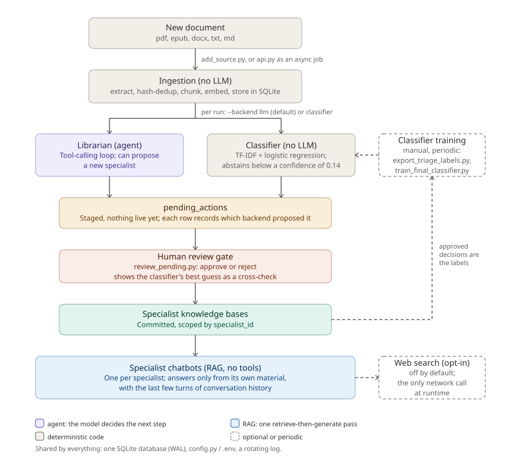
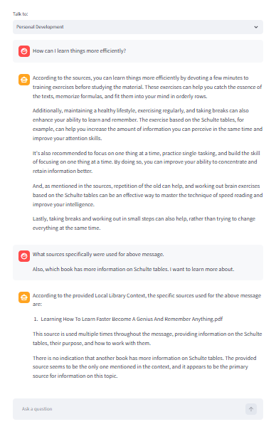
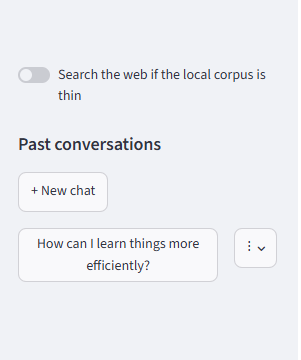
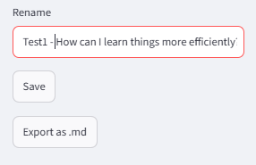
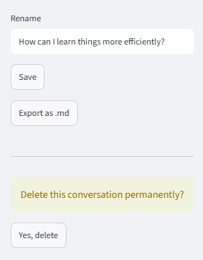
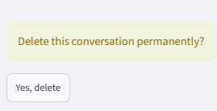

# Codex

A personal document library that curates itself. One tool-calling agent (the
Librarian) triages new documents into scoped specialist knowledge bases, gated
by a human-approval step before anything goes live. Several separate,
non-agentic RAG chatbots — one per specialist — answer questions grounded only
in their own committed material, with bounded conversation memory and an
opt-in web-search fallback.

Built to run on modest hardware (8GB RAM, no GPU). After a one-time model
download at setup, nothing leaves the machine: the only network call at
runtime is an opt-in web-search toggle in chat, off by default.



## The one question that decides everything

For every component in this project, ask: **is there a loop where the model
decides what happens next?**

If a component hands an LLM tools, lets it call one, feeds the result back,
and lets the model decide the next step based on what it just learned —
repeating until the model decides it's done — that's an **agent**. If a
component does retrieve → build a prompt → generate, once per turn, with no
branching on the output, that's **RAG**.

This project has exactly one agent (the Librarian) and several RAG chatbots —
one per specialist. That 1-to-many ratio is the whole architecture.

| Component | Tools? | Multi-step loop? | Writes to live DB? | Classification |
|---|---|---|---|---|
| Librarian | Yes (5) | Yes, capped | No — stages proposals only | Agent |
| Specialist chat (one per active specialist) | None | No — one retrieval+generation pass per turn | No | RAG |
| Classifier triage backend (optional) | N/A — no LLM | N/A | No — stages proposals only | Deterministic (TF-IDF + logistic regression) |
| Approval script | N/A — no LLM | N/A | Yes, after a human decides | Deterministic |
| Ingestion pipeline | N/A — no LLM | N/A | Yes, to a staging area | Deterministic |

The specialist chatbots have zero tools by design — a persona chatbot that can
only retrieve and generate cannot write to the database and cannot do
anything it wasn't explicitly wired to do. Each turn does carry the last few
exchanges of conversation history alongside its retrieval, so follow-ups read
naturally — but that's *context*, not agency: there's still no loop, no tool,
and no decision about what to do next. If a specialist ever needs to take an
action instead of just answering, that's a sign it should become a second
agent with its own approval gate, not a quiet exception to this one's
boundary.

## Setup

Python 3.10+ (developed on 3.13, which is also what CI runs) and [Ollama](https://ollama.com)
installed. Run everything from the repository root. Each code block below is meant to
run exactly as pasted, in the OS named above it.

**1. Get the code and an isolated environment**

```bash
git clone https://github.com/venkatesh16180/codex.git
cd codex
python -m venv .venv
```

Now activate it — in every new terminal, before anything else.

Windows (PowerShell):

```powershell
.venv\Scripts\activate
```

macOS / Linux:

```bash
source .venv/bin/activate
```

Your prompt should now start with `(.venv)`. If it doesn't, the next command installs
everything into your global Python instead.

```bash
python -m pip install -r requirements.txt
```

**2. Create your data folder and the database**

`data/` is gitignored: it holds your library, the database, the trained model and the log.
`data/your_library` is where the usage examples below expect your documents.

Windows (PowerShell):

```powershell
mkdir data\your_library
```

macOS / Linux:

```bash
mkdir -p data/your_library
```

Then, on either:

```bash
cp .env.example .env
python -c "import sqlite3; c = sqlite3.connect('data/librarian.db'); c.executescript(open('schema.sql', encoding='utf-8').read()); c.close()"
python seed_specialists.py
```

`.env` is optional — every value has a default in `config.py`. (On macOS / Linux with the `sqlite3`
command-line tool, `sqlite3 data/librarian.db < schema.sql` does the same as the one-liner;
PowerShell doesn't support `<`, so use the one-liner there.)

**3. Download the models (needs internet, once)**

Start Ollama first — the desktop app, or `ollama serve` in a second terminal — then:

```bash
ollama pull qwen3:4b
ollama pull llama3.2
python download_models.py
```

`qwen3:4b` is the Librarian (it needs reliable tool-calling); `llama3.2` answers chat questions.
If the first `ollama pull` fails with "timed out waiting for server to start", Ollama was
still starting — run it again. `download_models.py` then fetches the embedding model and
checks that both Ollama models are present.

**4. Check it**

```bash
python -m pytest -q
```

> **Why `download_models.py`?** The scripts that load the embedding model
> (`add_source.py`, `ingest.py`, `streamlit_app.py`, `api.py`) set
> `HF_HUB_OFFLINE=1` so a running system never touches the network. On a fresh machine the embedding
> model isn't cached yet, and offline mode forbids fetching it — the first
> run fails with a "couldn't connect to huggingface.co" error. `download_models.py`
> does that download once, deliberately without the offline flag.

> `get_connection()` will silently create an empty `librarian.db` if one
> doesn't exist — it never runs `schema.sql` itself. Run the bootstrap step
> above before anything else, or later scripts will fail with
> `no such table` rather than a missing-file error. The same applies to schema
> changes: editing `schema.sql` never alters an existing database, so upgrades
> come as `migrate_*.py` scripts (see Project structure).

## Usage

```bash
python add_source.py "data/your_library/*"                      # ingest + triage with the Librarian (LLM)
python add_source.py "data/your_library/*" --backend classifier  # ...or the fast classifier (needs a trained model; not on a fresh clone)
python review_pending.py                                          # approve or reject staged proposals
streamlit run streamlit_app.py                                    # chat with a specialist
```

Two seed specialists (`philosopher_mentor`, `fitness_mentor`) exist by hand at
setup; every other specialist grows through the Librarian proposing one when
a document doesn't fit anything that exists — including a draft persona
style — subject to the same approval gate as everything else.

Ingestion and approval are deliberately two separate commands. `add_source.py`
never commits anything to a specialist; nothing goes live until
`review_pending.py` has a human decision behind it. Re-running `add_source.py`
on a file it has already ingested is a no-op (files are deduplicated by content
hash). If triage fails for a document *after* it was ingested, `add_source.py`
reports it and exits non-zero — a rerun skips that document, so use
`python retriage_orphaned.py` (add `--backend classifier` for the fast path, or
`--list` to just see what it would triage).



Every answer is grounded in the specialist's own committed material only —
each retrieved passage carries its source title, and the model names it when
asked. The follow-up above ("what sources were used for above message?")
works because the last few turns of conversation ride along with each new
question, not just the current one in isolation.



The web-search toggle and the full conversation history — past sessions,
rename, export to markdown, delete — live in the sidebar, not above the chat,
so they stay reachable no matter how long a conversation gets.

Session titles are just the first ~50 characters of a session's opening
question, with no deduplication — two sessions that start the same way will
show identical labels until renamed:






Deleting a session requires a second, explicit confirmation click rather than
firing immediately — a stray click can't silently wipe a conversation.

If the model call fails (timeout, Ollama not running, model not installed),
the page shows an error and saves nothing for that turn, so a failed question
never shows up as an answered one.

### Follow-up questions

A short follow-up ("what did you just say?") has almost no content of its own,
so its similarity to the library falls below the relevance floor even though
the conversation is squarely about the specialist's material. When that
happens, retrieval is retried with the *previous* question, and the model
gets that context plus the conversation history. Every turn logs one line to
`data/codex.log` so the behavior is inspectable:

```
chat_retrieval specialist=philosopher_mentor top_score=0.2765 floor=0.30 followup_fallback=True fallback_score=0.4635
```

If nothing in the specialist's material is close enough — even via the
fallback — the answer says so, instead of guessing.

### The API (optional)

```bash
uvicorn api:app
```

`POST /documents` with `{"file_path": "data/your_library/book.pdf", "backend": "llm"}`
starts ingestion and triage as a background job and returns a `job_id`;
`GET /documents/{job_id}` reports status and elapsed time. LLM triage on CPU can
take far longer than any sensible HTTP timeout, which is why it's a job you poll
rather than a request you wait on. Job records live in the `jobs` table; the
background thread itself does not survive a restart, so a job interrupted
that way is marked as an error when the server next starts. Use forward slashes in `file_path` on Windows
(a backslash is a JSON escape character).

> The API has no authentication and reads any file path the server process can
> see. It's meant for `localhost` on a machine you control — don't expose it.

## Configuration

Every setting has a default in `config.py` and can be overridden in `.env`
(see `.env.example`):

| Variable | Default | What it does |
|---|---|---|
| `CODEX_DB_PATH` | `data/librarian.db` | SQLite database |
| `CODEX_LIBRARIAN_MODEL` | `qwen3:4b` | Tool-calling model for the Librarian |
| `CODEX_CHAT_MODEL` | `llama3.2` | Model for specialist chat |
| `CODEX_HISTORY_TURNS` | `3` | Prior question/answer pairs fed back into each turn |
| `CODEX_RELEVANCE_THRESHOLD` | `0.3` | Similarity floor below which retrieval counts as irrelevant |
| `CODEX_NUM_CTX` | `8192` | Ollama context window |
| `CODEX_LLM_TRIAGE_TIMEOUT_SEC` | `10800` | Read timeout for Librarian calls |
| `CODEX_LLM_CHAT_TIMEOUT_SEC` | `420` | Read timeout for chat calls |
| `CODEX_LLM_CONNECT_TIMEOUT_SEC` | `10` | Connect timeout (a dead server fails fast) |
| `CODEX_MAX_CHARS_WARNING` | `500000` | Warn — never reject — when a document is larger than this |
| `CODEX_LOG_LEVEL` / `CODEX_LOG_PATH` | `INFO` / `data/codex.log` | Logging (rotating file, 2 MB x 3) |

The ones worth knowing about:

- `CODEX_HISTORY_TURNS` — bounded deliberately, not unlimited — cost per call
  stays roughly constant as a conversation grows, rather than compounding.
- `CODEX_RELEVANCE_THRESHOLD` — the same cosine-similarity noise floor
  `test_isolation.py` uses to separate real matches from cross-topic noise. It's
  a borrowed heuristic: see Known limitations, and use the `chat_retrieval` log
  lines above if you want to tune it against your own library.
- `CODEX_NUM_CTX` — Ollama commonly defaults to `2048`, which is thin once
  retrieved chunks, source labels, and history are all accounted for.

## Triage backends

`add_source.py` takes `--backend llm` (default) or `--backend classifier`.

| | `llm` (the Librarian) | `classifier` |
|---|---|---|
| How it decides | A tool-calling loop over the roster, with a precedent search | TF-IDF + logistic regression trained on your own approved decisions |
| Speed | Minutes to hours per document on a CPU-only machine | Milliseconds |
| Can propose a new specialist | Yes | No — it can only choose an existing one, or abstain |
| When unsure | Flags for manual review | Abstains below a confidence threshold (`0.14`) to manual review |

Both only ever *stage* proposals in `pending_actions`; the review step is the
same either way. `review_pending.py` also shows the classifier's independent
best guess and confidence next to every LLM proposal, marked informational.

The classifier needs a trained model (`data/triage_classifier.joblib`), built from
your own committed decisions by the pipeline under Maintenance — so it only exists
once you have a few approved documents per specialist. At its last recalibration
(27 documents, 9 classes) leave-one-out accuracy was 19/27 (70.4%) — within noise across scikit-learn
versions (a rerun on 1.8.0 instead of the pinned 1.9.0 gave 18/27). An earlier benchmark
found the LLM backend more accurate and many orders of magnitude slower; those
figures predate later changes to the Librarian's input, so treat them as
directional.

## Testing and CI

```bash
python -m pytest -q
```

Only the model call is faked in the agent and chat tests; the tools, the loop,
retrieval and the database are real. Two kinds of database are used:

- Tests that take the `conn` fixture run against your **real** database via
  `get_connection()`, inserting and deleting their own throwaway rows — the
  convention inherited from `test_isolation.py` (itself a standalone manual runner,
  excluded from pytest by `pytest.ini`).
- Tests that take `fresh_db` build an isolated in-memory database from
  `schema.sql`. Anything that writes to `pending_actions`, or that must prove
  `schema.sql` itself builds, uses this.

Test runs log to a temp file, not `data/codex.log`.

CI (`.github/workflows/tests.yml`) runs on every push: it builds a schema-only
database from `schema.sql`, installs `requirements.txt`, runs pytest, then runs
`check_requirements_drift.py` (every package named in `requirements.in` must
appear in `requirements.txt`). CI has no Ollama, so nothing there exercises a
real model — that's what the manual checks are for.

## Maintenance

### Recalibrating the triage classifier

The classifier backend is a static model trained on whatever was committed at
the time it was last built. It doesn't update itself as the library grows, and
its accuracy and confidence threshold are only as good as the corpus it saw
last. Worth re-running this pipeline periodically — after approving a batch of
new documents, or if the cross-check predictions in `review_pending.py` start
looking consistently off:

```bash
python export_triage_labels.py                       # refresh data/triage_labels.jsonl
# check EXCLUDED_SLUGS in train_baseline_classifier.py matches current singletons:
sqlite3 data/librarian.db "SELECT sp.slug, COUNT(DISTINCT dc.document_id) FROM specialist_chunks sc JOIN document_chunks dc ON dc.chunk_id=sc.chunk_id JOIN specialists sp ON sp.specialist_id=sc.specialist_id GROUP BY sp.slug HAVING COUNT(DISTINCT dc.document_id) < 2;"
python train_baseline_classifier.py                   # leave-one-out accuracy + per-document confidence (4 decimals)
# do the correct and wrong confidences still separate? update CONFIDENCE_THRESHOLD in
# classifier_triage.py only if the evidence supports it; a documented non-change is valid
python train_final_classifier.py                       # persist the model; confirm n_docs and n_classes in the log
```

Training and serving build their input text with the same function
(`content_preview.build_classifier_text`), and the saved model records what it
was trained on (document count, classes, text length, scikit-learn version).
Loading a model warns if the scikit-learn version or text length no longer
matches, or if the model predates that record — retrain when it does. The
accuracy figure from `train_baseline_classifier.py` is the number to compare
before and after, but only like for like: a different corpus or text recipe is a
new baseline, not an improvement or a regression.

This is a manual, judgment-driven process, not something in CI — it needs
your real, uncommitted library content, and "accuracy regressed" isn't
something a script should silently gate on.

## Project structure

```
codex/
├── config.py                    # every setting, env-overridable (see Configuration)
├── logging_setup.py             # console + rotating file log
├── db.py                        # centralized connection handling
├── schema.sql                   # source of truth for a fresh database
├── extract.py                   # pdf/epub/docx/txt text extraction
├── chunk.py                     # chunk_text
├── embeddings.py                # serialize/deserialize, cosine_similarity
├── content_preview.py           # front-matter detection; classifier text prep shared by training and serving
├── ingest.py                    # hash-dedup, extract, chunk, embed
├── add_source.py                # ingest + triage (--backend llm|classifier), end to end
├── retriage_orphaned.py         # triage documents that were ingested but never triaged
├── agent.py                     # the Librarian: tools + reasoning loop
├── ollama_retry.py              # retries connection errors with backoff; never retries a read timeout
├── classifier_triage.py         # the classifier backend, with its confidence gate
├── export_triage_labels.py      # committed decisions -> labeled JSONL
├── train_baseline_classifier.py # leave-one-out evaluation
├── train_final_classifier.py    # fits and saves the model, with metadata
├── benchmark_llm_vs_classifier.py # multi-hour LLM-vs-classifier comparison (resumable)
├── review_pending.py            # human approval gate
├── search.py                    # search_specialist (scoped retrieval)
├── chat.py                      # chat_with_specialist (grounded RAG)
├── history.py                   # session persistence
├── web_search.py                # fetch_web_context -- the opt-in, non-offline exception
├── streamlit_app.py             # chat UI: specialist picker, sidebar, toggle
├── api.py                       # FastAPI: async triage submission, job status
├── download_models.py           # one-time setup: embedding model + Ollama model check
├── seed_specialists.py          # seeds the two hand-picked specialists
├── verify_stack.py              # Phase 1 offline-stack check (fresh database only)
├── migrate_add_chat_history.py  # one-time: chat_sessions/chat_messages
├── migrate_add_jobs.py          # one-time: jobs table
├── migrate_add_source_backend.py # one-time: pending_actions.source_backend
├── check_requirements_drift.py  # CI: requirements.in vs requirements.txt
├── conftest.py, pytest.ini      # pytest fixtures (conn, fresh_db) and config
├── test_*.py                    # pytest tests; test_isolation.py is a standalone manual runner
├── .github/workflows/tests.yml  # CI
├── .streamlit/config.toml       # Streamlit: file watcher off (see Known limitations)
├── .env.example, requirements.in, requirements.txt
├── LICENSE
├── README.md
├── docs/images/                 # architecture diagram, app screenshots
├── dev_checks/                  # gitignored scratch scripts, not part of the project
└── data/                        # gitignored — your library, librarian.db, the model, the log
```

## Known limitations

- **Conversation memory only covers the last `CODEX_HISTORY_TURNS` (3)
  exchanges.** Older turns are genuinely forgotten mid-session, not
  summarized or retained elsewhere — a deliberate bound, not an oversight, to
  keep per-call cost from growing as a conversation gets longer.
- **Recall spanning several turns back, or enumerating multiple things
  mentioned earlier in a conversation, is unreliable** — even after fixing a
  real grounding-prompt conflict, adding a retrieval-relevance floor, and
  setting `num_ctx` explicitly. Follow-ups to the most recent turn work much
  better, but not reliably: with the same setup, "what did you just say?" has both
  restated the previous answer correctly and described an unrelated passage
  from the retrieved context. Most likely a capability limit of a small model
  at this size, not a remaining code defect — investigated, not fully proven
  either way, and not chased further.
- **A follow-up only borrows the *previous* question's retrieval.** A chain of
  content-free messages ("what did you just say?", then "ok thanks") can't
  recover the earlier on-topic question, and gets the "nothing matches" answer.
- **The relevance floor is a heuristic, not a precise signal.** In one
  specialist a follow-up ("what did you just say?") scored 0.28 and an unrelated
  question ("what's the capital of France?") scored 0.25 — too close for
  similarity alone to separate them. Very short or ambiguous queries can fall on
  either side of the cutoff within the same conversation.
- **Web-enabled chat can occasionally cite specific-sounding details that
  exist in neither the local corpus nor the raw web results.** Confirmed via
  direct provenance checks; inconsistent run-to-run, not a constant bug.
  Instruction-following toward "only use the provided context" is a strong
  bias, not an airtight guarantee — not solvable by prompt tweaking alone.
- **`used_web` on `chat_messages` records whether the toggle was on, not
  whether web content was actually retrieved and used.** Web search can
  silently return nothing (rate-limited, offline) and the turn still gets
  tagged `used_web=True`.
- **The Librarian sometimes proposes a new specialist that overlaps an
  existing one.** The approval gate is what catches it (reject, then restage the
  document against the existing specialist), and it has happened more than once.
- **A document whose triage fails after ingestion is skipped by a rerun of
  `add_source.py`**, because ingestion deduplicates by content hash.
  `add_source.py` reports these documents, and `python retriage_orphaned.py`
  triages them — an orphan is defined as "not committed, and no `pending_actions`
  row at all", since that row is only ever created by a successful triage.
- **The same book as a PDF and an EPUB ingests twice** — dedup is by file hash,
  not by content.
- **The classifier is trained on a small corpus.** At its last recalibration
  (27 documents, 9 classes) four specialists with a single document were
  excluded from evaluation, and its confidences sit close to the floor of about
  0.11 for nine classes: the highest-scoring error was 0.1380 and the lowest
  accepted correct prediction 0.1415. At the `0.14` threshold all 13 accepted
  predictions were correct and all 8 errors abstained, but 6 of the 19 correct
  predictions abstained too — a margin of about 0.002 on each side, chosen on
  the same 27 documents, so it is a fine cut on a small corpus, not a tuned
  optimum.
- **Front-matter detection can fall back to the start of the file.** If no run
  of three clean chunks is found in the first 30, a document's preview and
  classifier text begin at chunk 0, copyright page included.
- **PDF extraction includes watermark boilerplate from piracy-site source
  material** (e.g. `OceanofPDF.com`) in chunk text. Left as-is — retrievable,
  not publication-clean, was the deliberate scoping call — but the model
  occasionally cites it as if it were a real source name.
- **CPU-only inference on modest hardware makes triaging a large folder slow.**
  Expected and worth planning around — triage a handful of documents at a
  time rather than a whole library in one sitting.
- **Streamlit's file watcher trips on an optional `transformers` dependency.**
  It imports every `transformers` submodule and prints a wall of harmless
  `torchvision` tracebacks. `.streamlit/config.toml` turns the watcher off, which
  silences them — at the cost of auto-reload on save, so restart Streamlit after
  changing code.

## Tech stack

Ollama (`qwen3:4b` for the Librarian, `llama3.2` for chat), sentence-transformers
(`all-MiniLM-L6-v2`), SQLite, scikit-learn (the classifier backend), Streamlit
(chat UI), FastAPI + uvicorn (the job API), pytest, GitHub Actions — all offline
at runtime except the opt-in web-search toggle.

## License

MIT — see [LICENSE](LICENSE).
